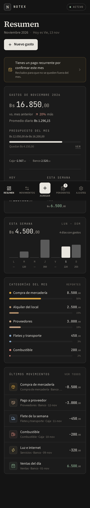

# Notex

Gestor de gastos para una comercializadora, privado y local-first, para Windows
y Android.

Notex registra las compras, los pagos a proveedores y los gastos de operación en
segundos. Muestra cuánto gastó el negocio hoy, esta semana, este mes y este año,
controla presupuestos, sigue los pagos recurrentes mes a mes y sincroniza la
laptop con el celular sin cuentas en la nube.

- **Moneda:** bolivianos (`Bs 1.234,56`), español de Bolivia.
- **Escritorio:** Windows (Tauri 2 + WebView2).
- **Celular:** Android (misma interfaz, adaptada a pantalla táctil).
- **Datos:** SQLite local en cada equipo. La laptop hace de servidor de
  sincronización y el celular se conecta por una red privada de Tailscale.

## Vista previa



Más pantallas en [`docs/vista-movil.md`](docs/vista-movil.md). Los datos de las
capturas son de ejemplo.

## Stack

- **Rust:** SQLite (`rusqlite`), modelo de datos, cálculos, servidor de sync
  (`axum`) y cliente HTTP (`reqwest`).
- **React 19 + TypeScript + Vite + Tailwind CSS 4:** interfaz.
- **Tauri 2:** empaquetado de Windows y Android.

## Desarrollo

### Requisitos

- Node 20 o superior.
- Rust estable.
- Linux: dependencias de Tauri (WebKitGTK, GTK 3).
- Android: JDK 17, SDK de Android 35, NDK 27 y los targets de Rust para Android.

En este equipo el toolchain de Android quedó instalado en la carpeta del usuario:

```bash
export JAVA_HOME="$HOME/.local/share/jdk17"
export ANDROID_HOME="$HOME/.local/share/android-sdk"
export ANDROID_SDK_ROOT="$HOME/.local/share/android-sdk"
export NDK_HOME="$HOME/.local/share/android-sdk/ndk/27.0.12077973"
export PATH="$JAVA_HOME/bin:$ANDROID_HOME/platform-tools:$PATH"
```

### Escritorio

```bash
npm install
npm run tauri dev
```

La app abre en una ventana. Al cerrarla queda en la bandeja del sistema para que
el servidor de sincronización siga disponible; se sale desde el menú de la
bandeja.

Compilar el instalador:

```bash
npm run tauri build
```

### Android

La primera vez:

```bash
npm run tauri android init -- --ci
```

Generar un APK de depuración para un teléfono ARM64:

```bash
npm run tauri android build -- --debug --apk --target aarch64
```

El APK de depuración queda en
`src-tauri/gen/android/app/build/outputs/apk/universal/debug/` y se instala en
el celular con `adb install` o copiándolo y abriéndolo.

Para una versión release firmada:

```bash
npm run tauri android build -- --apk --target aarch64
```

El APK queda en
`src-tauri/gen/android/app/build/outputs/apk/universal/release/`. La firma usa
el keystore de `~/.local/share/notex/notex-release.jks`; las credenciales están
en `~/.local/share/notex/keystore.txt` y **no** se commitean. Guardar esos dos
archivos: sin ellos no se pueden publicar actualizaciones firmadas.

En este equipo ya hay un APK release en `/home/anthony/Notex-0.1.0.apk`.

## Sincronización

### Una sola vez: Tailscale

1. Instalar Tailscale en la laptop y en el celular.
2. Iniciar sesión con la misma cuenta en los dos equipos.
3. Verificar que la laptop tenga una dirección `100.x.x.x`.

Tailscale no expone la app a internet: solo tus dispositivos se ven entre sí y
el tráfico va cifrado.

### Emparejar

En la laptop:

1. Ajustes → Sincronización.
2. Copiar la dirección que empieza con `100.` (la de Tailscale).
3. Generar un código de 6 dígitos.

En el celular:

1. Ajustes → Sincronización.
2. Pegar la dirección y el código.
3. Conectar.

Después de eso, los cambios se empujan y se bajan solos cada 20 segundos
mientras la app está abierta. Si la laptop está apagada, el celular sigue
funcionando y los cambios quedan pendientes con un aviso visible.

### Cómo funciona

- Cada cambio local se guarda en `change_log` con el `device_id` que lo originó.
- El servidor expone `/pair`, `/sync/push` y `/sync/pull` con autenticación por
  token (`Bearer`).
- Los conflictos se resuelven por `updated_at` y, si empatan, por `device_id`
  (last-write-wins). Con un solo usuario son raros; las bajas son lógicas
  (`deleted_at`) para que se propaguen.
- Las fechas de los gastos son fechas calendario (`YYYY-MM-DD`), no instantes:
  los totales semanales y mensuales no se corren por zona horaria.

### Puerto

El servidor escucha en `8787` y, si está ocupado, prueba los siguientes hasta
`8799`. La dirección aparece en Ajustes.

## Datos y respaldo

- Base de datos: carpeta de datos de la app (`Ajustes → Datos y respaldo` muestra
  la ruta exacta).
- Copia de seguridad: botón en Ajustes; se guarda en `backups/`.
- Exportación: CSV con todos los movimientos en `exports/`.
- El celular guarda una copia completa de los datos. Si se pierde la laptop, los
  datos siguen en el teléfono.

## Estructura

```
src/                  Interfaz React
  components/         Shell, componentes de UI, avisos
  lib/                API, tipos, formato, estado global
  screens/            Resumen, Movimientos, Agregar, Pendientes, Presupuestos,
                      Reportes, Ajustes
src-tauri/
  src/db.rs           Esquema, consultas, cálculos y semilla
  src/commands.rs     Comandos de Tauri
  src/sync.rs         Servidor axum + cliente de sincronización
  src/sync_store.rs   Change log, LWW y aplicación de cambios
  gen/android/        Proyecto Android generado por Tauri
PRODUCT.md            Contexto de producto
DESIGN.md             Sistema visual
```

## CI

El workflow está en `.github/workflows/build.yml` y ya está activo. Se puede
ejecutar a mano desde **Actions → builds → Run workflow**, o al empujar un tag
`v*`. Genera dos artefactos:

- `notex-windows`: instalador NSIS para Windows.
- `notex-android`: APK de depuración ARM64.

Los artefactos se descargan desde la página de la corrida. El APK de release
firmado se genera localmente (ver arriba) porque usa el keystore que no está en
el repo.

## Estado

Funciona:

- Gastos, ingresos y transferencias.
- Resumen diario, semanal, mensual y anual.
- Categorías, cuentas, presupuestos y recurrentes.
- Reportes de 12 meses.
- Sincronización laptop ↔ celular con emparejamiento por código.
- Backups y exportación CSV.

- APK release firmado con keystore propio.
- Navegación con el botón Atrás de Android.
- Bandeja del sistema en escritorio (la app sigue disponible al cerrar la
  ventana).

Pendiente para la próxima etapa:

- Instalador de Windows en CI (el workflow está en `docs/build-workflow.yml`).
- Inicio automático con Windows.
- PIN de bloqueo y fotos de tickets.
- Prueba en un teléfono Android real y ajuste de insets/teclado.
