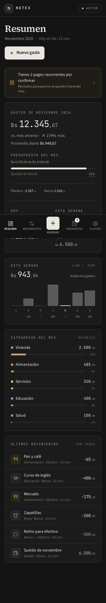
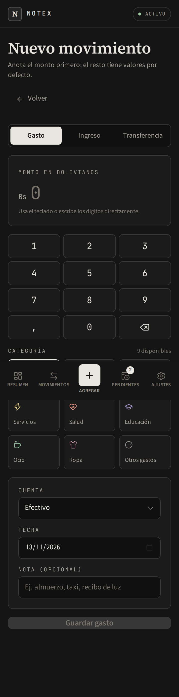
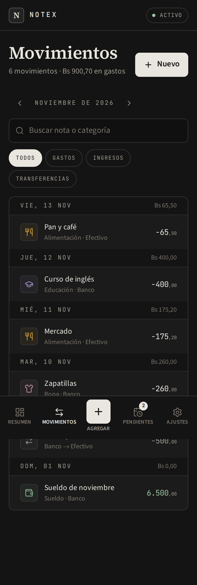
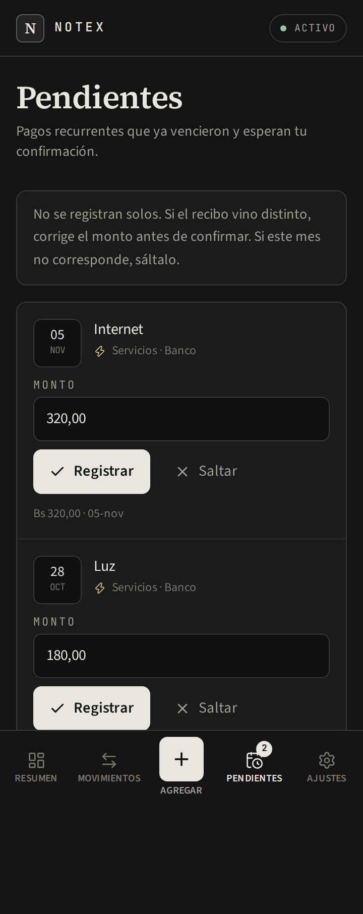
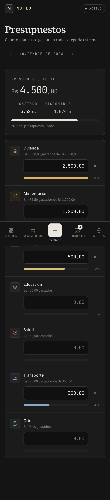
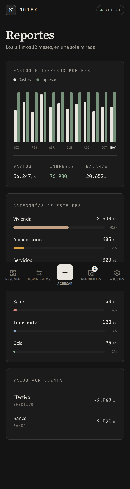
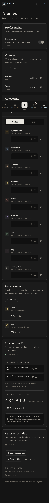

# Notex en el celular

Renderizado a **360 px de ancho**, el mismo ancho lógico del Honor X6c (720 px
físicos, densidad 2). Los montos y nombres son datos de ejemplo.

La versión interactiva está en `vista-movil.html` (abrir en un navegador).

## Resumen

## Agregar

## Movimientos

## Pendientes

## Presupuestos

## Reportes

## Ajustes

## Icono

